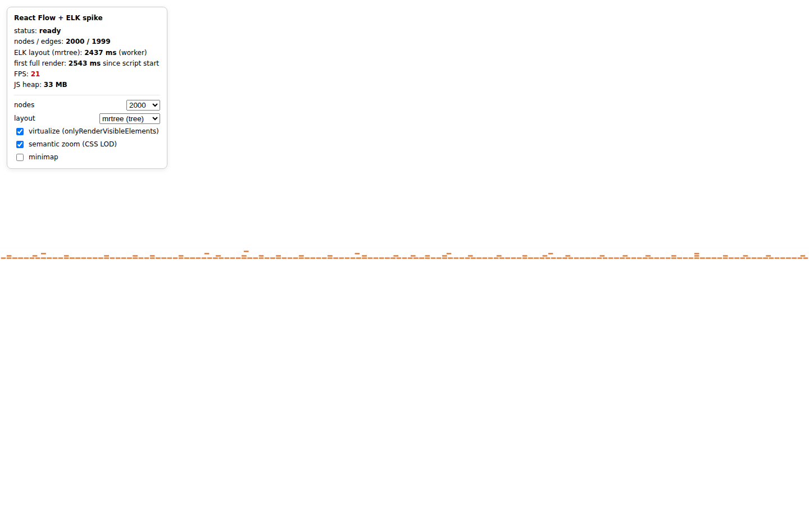

# OrgChart spike — React Flow (xyflow) + ELK with ~2,000 nodes

Throwaway proof of concept to answer one question: **does React Flow + ELK hold up for a
map-style org chart with 2,000–5,000 people, and where does it break?**

Not pretty, not clean. It works and it measures itself.



## Run it

Requires Node 20+.

```bash
npm install
npm run dev        # http://localhost:5173
```

Everything is configurable from the panel (top-left) or the URL:

| param | default | meaning |
|---|---|---|
| `n` | `2000` | number of people (500 … 10000) |
| `algo` | `mrtree` | ELK algorithm: `mrtree` (tree) or `layered` (DAG, supports dual reporting) |
| `virt` | `1` | `onlyRenderVisibleElements` (React Flow virtualization) |
| `lod` | `1` | semantic zoom: CSS-only level of detail driven by zoom |
| `minimap` | `0` | show MiniMap |

Example: `http://localhost:5173/?n=5000&virt=0`

## Profile it

Headless Chromium drives a scripted 3 s pan and 3 s zoom per variant and records
frame times, long tasks and JS heap through the Chrome DevTools Protocol.

```bash
npm run build
npm run profile              # 5 variants, normal CPU
CPU=4 npm run profile        # 4x CPU throttling ≈ mid-range laptop
```

If Playwright complains about a missing browser: `npx playwright install chromium`
(or point `CHROME=/path/to/chrome`). Results print as a table and are saved in `profiling/`.

For manual profiling open the app in Chrome and use **React DevTools › Profiler**
(nodes are `memo`'d; pan/zoom should show ~0 node commits when `virt=0`) and
**Performance panel › Frames / Main** with CPU throttling at 4x.

## What is in the code

- `src/data/generateOrg.ts` — deterministic fake org (seeded), so runs are comparable.
- `src/layout/elk.ts` — ELK runs in a Web Worker (`elk-worker.min.js?url`) so layout never blocks the UI.
- `src/nodes/PersonNode.tsx` — `memo`'d custom node. Level of detail is pure CSS (`[data-lod]`), so zooming re-renders zero nodes.
- `src/App.tsx` — React Flow setup, HUD, `window.__spike` metrics the profiler reads.
- `scripts/profile.mjs` — Playwright + CDP profiler.

## Results (headless Chromium, software rendering, 1440×900)

Absolute numbers are from a container without GPU — treat them as a **floor**; a real
laptop with GPU compositing will do better. The *relative* differences are what matter.

**Normal CPU**

| variant | ELK layout | first full render | DOM nodes | pan FPS avg / p5 | zoom FPS avg / p5 | long tasks | heap |
|---|---|---|---|---|---|---|---|
| 2,000 · virtualized · LOD | 2.5 s | 2.7 s | 182 / 2000 | 40 / 19 | 50 / 19 | 0 | 38 MB |
| 2,000 · **no** virtualization | 2.7 s | 2.7 s | 2000 / 2000 | 21 / 9 | 29 / 13 | 170 | 74 MB |
| 2,000 · virtualized · no LOD | 2.7 s | 2.9 s | 182 / 2000 | 34 / 18 | 49 / 19 | 2 | 15 MB |
| 5,000 · virtualized · LOD | 7.8 s | 7.9 s | 187 / 5000 | 37 / 19 | 52 / 28 | 0 | 99 MB |
| 2,000 · layered algo | 3.2 s | 3.4 s | 474 / 2000 | 16 / 11 | 39 / 14 | 111 | 52 MB |

**4x CPU throttling (mid-range laptop)**

| variant | ELK layout | first full render | pan FPS avg / p5 | zoom FPS avg / p5 | long tasks | heap |
|---|---|---|---|---|---|---|
| 2,000 · virtualized · LOD | 3.0 s | 3.5 s | 17 / 7 | 38 / 14 | 138 | 16 MB |
| 2,000 · **no** virtualization | 3.2 s | 3.6 s | 5.5 / 1.9 | 6 / 2.5 | 280 | 67 MB |
| 5,000 · virtualized · LOD | 11.3 s | 11.6 s | 12 / 5 | 30 / 11 | 156 | 15 MB |

(p5 = 5th-percentile FPS, i.e. the worst frames the user feels.)

## Findings

See the summary sent alongside this repo. Short version: rendering 2,000 nodes is fine once
virtualized; **ELK layout time** and the **width of a pure tree layout** are the real
problems, and React Flow's virtualization moves pan cost from paint onto the main thread.
